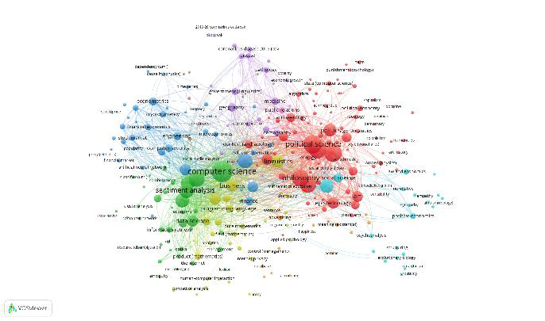
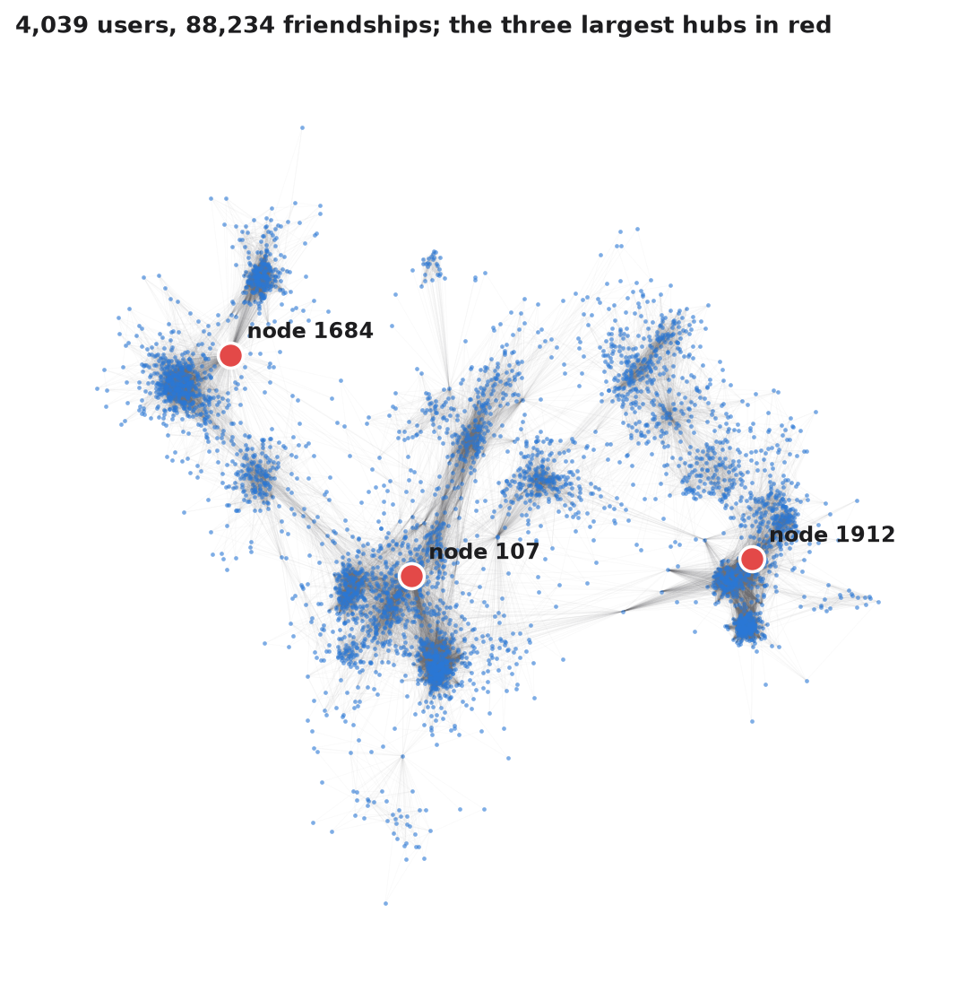
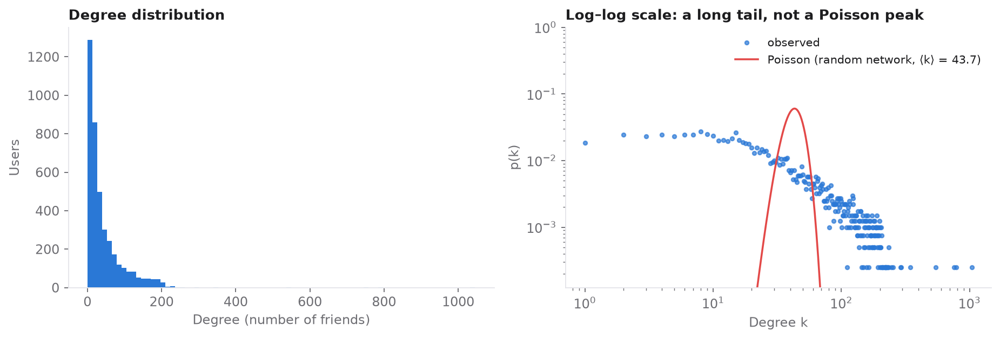

# Network Structures in Research Literature, Social Media and Text

   

**Case study:** [rolandkeszi.github.io/projects/network-analysis.html](https://rolandkeszi.github.io/projects/network-analysis.html)

This project applies network science tools to three kinds of human-generated data, as groundwork for sentiment analysis research:

1. **Research literature:** how publications on *sentiment analysis* are organised.
2. **A social network:** whether a Facebook friendship network is scale-free, and who its hubs are.
3. **Text:** whether similar social media messages form a network by topic.

## 1. The research landscape of sentiment analysis

Using bibliographic data on 2024 publications from the **OpenAlex API**, I mapped the terms that co-occur in abstracts with **VOSviewer** and analysed the network in **Gephi**.

<p align="center"></p>

| Measure | Value |
|---|---:|
| Network type | undirected |
| Nodes | 286 |
| Edges | 8,633 |
| Average degree | 60.37 |
| Average weighted degree | 209.67 |
| Density | 0.212 |
| Modularity | 0.232 |
| Communities | 3 |

- **Three research fields form dense clusters:** psychology and social psychology, which provide the theoretical grounding; political science, through elections and civic behaviour; and computer science, through the methods. NLP sits between them.
- **The degree distribution is scale-free:** a few highly connected publications and many weakly connected ones.
- **Choosing the right search term matters:** a search on *social sentiment* returns mostly COVID-19 papers, so *sentiment analysis* is the more relevant query.

## 2. Hubs and scale-free structure in a Facebook network

The [SNAP ego-Facebook network](https://snap.stanford.edu/data/ego-Facebook.html) has 4,039 anonymised users and 88,234 friendships. The notebook [`notebooks/facebook_network.ipynb`](notebooks/facebook_network.ipynb) reproduces this part end to end.

| Measure | Value |
|---|---:|
| Nodes / edges | 4,039 / 88,234 |
| Average degree | 43.69 |
| Average shortest path | 3.69 |
| Average clustering coefficient | 0.61 |
| Largest hubs | nodes **107, 1684, 1912** |

<p align="center"></p>

The network breaks into **distinct friendship circles**, which Louvain community detection finds as 16 communities with modularity 0.84. A few **hubs** connect hundreds of users each, while the median user has 25 friends.

<p align="center"></p>

The difference between a random network and a scale-free network shows in the **tail of the degree distribution**. A random network would follow a narrow Poisson peak around the mean degree. This network has a long, heavy tail instead: **the degree distribution follows a power law, so the network is not random** (Barabási, 2016).

## 3. A similarity network of social media messages

I processed a public set of political tweets with **spaCy**, measured the similarity between them with **TF-IDF**, and linked similar messages into a graph with **NetworkX** using a force-directed layout.

Tweets on the same topic **cluster together**, for example workplace sexual harassment, the Fair Housing Act, DACA renewals and a farmers' roundtable. Combining NLP and network methods makes topical structure in a text corpus visible.

A **pilot on a small student survey** used the same TF-IDF approach on 207 Hungarian open-ended answers. It gave no meaningful structure: the network of the 50 most frequent words was almost complete (average clustering 0.95). That result helped design later, larger studies. Its raw data are not published.

## Conclusions

- Network tools give a quick, **bird's-eye view of a research field** and help choose relevant search terms and literature.
- The Facebook network is **scale-free and dominated by a few hubs**, the hallmark of non-random social networks.
- **Text similarity networks** reveal topical clusters in social media, which is a useful step before sentiment analysis.
- Several tools were used side by side: Python (NetworkX, spaCy, NLTK, scikit-learn), Gephi, VOSviewer and SPSS.

## Run it

```bash
pip install -r requirements.txt
jupyter notebook notebooks/facebook_network.ipynb
```

The notebook downloads the SNAP data at run time. The figure from part 1 comes from the original analysis. The tweet network figure is not published, because it shows the authors' names.

## References

- Barabási, A.-L. (2016). *Network Science*. Cambridge University Press.
- McAuley, J., & Leskovec, J. (2012). Learning to discover social circles in ego networks. *NIPS*.
- Kobourov, S. (2012). Spring embedders and force-directed graph drawing algorithms. arXiv:1201.3011.
- Priem, J., Piwowar, H., & Orr, R. (2022). OpenAlex: a fully-open index of scholarly works, authors, venues, institutions, and concepts. arXiv:2205.01833.

## License

© 2026 Roland Keszi. This work is licensed under [CC BY-NC 4.0](https://creativecommons.org/licenses/by-nc/4.0/): you may share and adapt it for non-commercial purposes, provided you credit the author (Roland Keszi) and link to this repository. Third-party datasets keep their own licenses. See [`LICENSE`](LICENSE).
